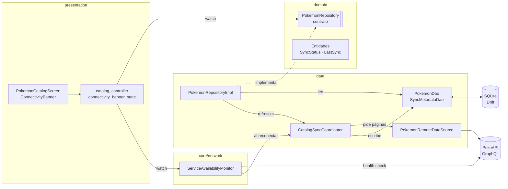
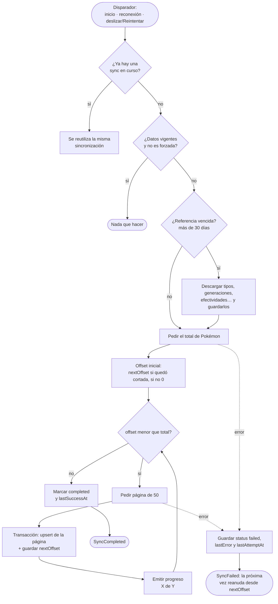
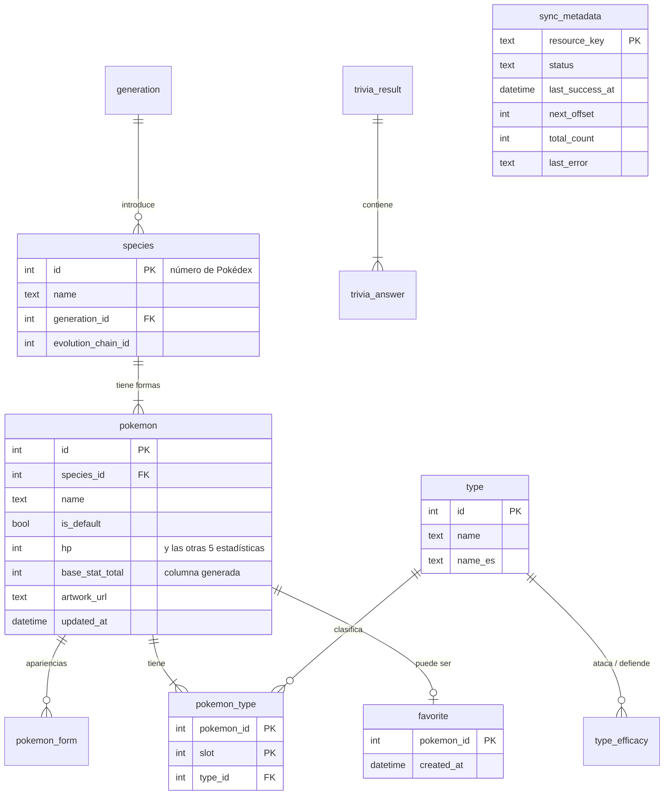
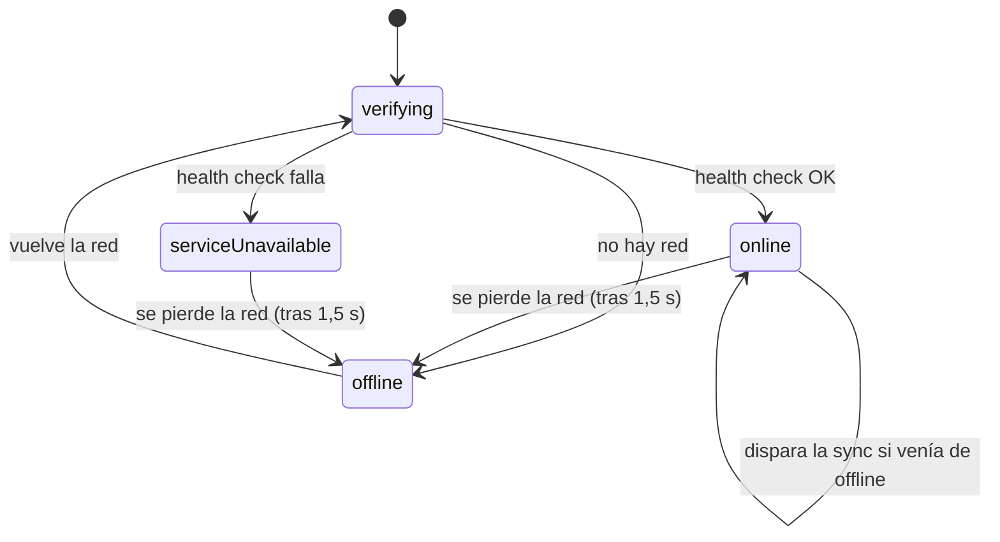

# Pokédex Offline-First

Aplicación Flutter que muestra el catálogo de la Pokédex nacional con datos de la
[API GraphQL de PokeAPI](https://pokeapi.co/docs/graphql). La aplicación sigue el enfoque
**offline-first**: todo lo que se descarga se guarda en una base de datos local (SQLite con
Drift), y la interfaz **solo lee de esa base**. La red sirve únicamente para mantener la
base actualizada.

| Integrante | Usuario de GitHub |
|---|---|
| José Comprés | `jmcompres` |
| Adrian Cruz | `adriancruz1015` |

> **Estado:** este README documenta el **avance** (≈40 %). Las secciones marcadas como
> *pendiente* se completan en la entrega final.

---

## Índice

1. [Descripción](#1-descripción)
2. [Requisitos de ejecución](#2-requisitos-de-ejecución)
3. [Instalación](#3-instalación)
4. [Tecnologías y justificación](#4-tecnologías-y-justificación)
5. [Arquitectura](#5-arquitectura)
6. [Estructura del proyecto](#6-estructura-del-proyecto)
7. [Estrategia Offline-First](#7-estrategia-offline-first)
8. [GraphQL y paginación](#8-graphql-y-paginación)
9. [Estrategia de sincronización](#9-estrategia-de-sincronización)
10. [Persistencia local](#10-persistencia-local)
11. [Gestión de conectividad](#11-gestión-de-conectividad)
12. [Funcionalidades adicionales](#12-funcionalidades-adicionales)
13. [Limitaciones conocidas](#13-limitaciones-conocidas)
14. [Decisiones de arquitectura (ADR)](#14-decisiones-de-arquitectura-adr)
15. [Uso de IA y código de terceros](#15-uso-de-ia-y-código-de-terceros)

---

## 1. Descripción

Implementado en el avance:

- **Catálogo** de los Pokémon por defecto de cada especie, con número de Pokédex nacional,
  nombre, imagen y tipos. Los estados de carga, vacío y error tienen botón «Reintentar».
- **Descarga paginada** desde GraphQL (páginas de 50) que se guarda sin duplicados y se
  **reanuda** donde quedó si se corta.
- **Funcionamiento offline**: el catálogo descargado se puede ver sin conexión, también
  después de cerrar y volver a abrir la aplicación.
- **Indicador global de conectividad** con cuatro estados: *Online*, *Offline*,
  *Servicio no disponible* y *Sincronizando*. Cada estado tiene icono y texto, y muestra
  la hora de la última sincronización.
- **Actualización manual** deslizando la lista hacia abajo. También restaura los datos del
  catálogo que se hayan alterado en la base local.
- **Caché de imágenes** en memoria y en disco: las imágenes ya vistas se muestran sin
  conexión.

## 2. Requisitos de ejecución

| Requisito | Versión |
|---|---|
| Flutter | **3.50.0** (fijada en `pubspec.yaml`, la misma que usa la CI) |
| Dart | La que trae Flutter 3.50.0 (`sdk: ^3.13.5`) |
| Plataforma | Android (emulador o dispositivo) con el `minSdk` por defecto de Flutter |
| Red | Solo para la primera descarga y las actualizaciones; después funciona sin conexión |

## 3. Instalación

```bash
git clone https://github.com/jmcompres/pokedex.git
cd pokedex
flutter pub get
flutter run
```

Los archivos generados por Drift (`*.g.dart`) están en el repositorio, así que no hace falta
generarlos para ejecutar. Hay que regenerarlos solo si se modifica una tabla o un DAO:

```bash
dart run build_runner build --delete-conflicting-outputs
```

Pruebas y análisis (lo mismo que ejecuta la CI en cada *pull request*):

```bash
dart format --output=none --set-exit-if-changed .
flutter analyze --fatal-infos --fatal-warnings
flutter test
```

## 4. Tecnologías y justificación

| Dependencia | Para qué se usa | Por qué esta y no otra |
|---|---|---|
| `drift` + `drift_flutter` | Base de datos local (SQLite) | Tablas y consultas con tipos verificados al compilar, claves foráneas, índices, transacciones y consultas **observables** (`watch()`), que es lo que permite que la interfaz se actualice sola. Ver [ADR-0001](docs/adr/0001-drift-como-persistencia-local.md). |
| `drift_dev` + `build_runner` *(dev)* | Generación de código de Drift | Drift genera las clases de filas, *companions* y DAOs a partir de las tablas escritas en Dart. |
| `graphql` | Cliente de la API GraphQL de PokeAPI | Cliente maduro, con soporte de variables y manejo de errores de red y de GraphQL. Se usa **sin caché** (`FetchPolicy.noCache`), porque la caché real es Drift. |
| `flutter_riverpod` | Estado e inyección de dependencias | Los *providers* conectan las capas sin que una cree las dependencias de otra, permiten sustituir implementaciones en pruebas y exponen *streams* a la interfaz. Ver [ADR-0002](docs/adr/0002-riverpod-para-estado-e-inyeccion.md). |
| `go_router` | Navegación | Rutas declarativas, listas para las pantallas de la entrega final (detalle, favoritos, trivia). |
| `connectivity_plus` | Detectar cambios de la interfaz de red | Avisa al instante cuando se pierde o recupera la red. Como tener Wi-Fi no garantiza que la API responda, se combina con una verificación real de la API. Ver [ADR-0006](docs/adr/0006-disponibilidad-real-del-servicio.md). |
| `cached_network_image` + `flutter_cache_manager` | Caché de imágenes en disco y memoria | Guarda las imágenes ya descargadas y las sirve sin conexión, con límite de espacio y limpieza automática. Ver [ADR-0004](docs/adr/0004-cache-de-imagenes.md). |
| `equatable` | Igualdad por valor | Las entidades y estados se comparan por contenido, sin escribir `==` y `hashCode` a mano. |
| `material_ui` | Widgets de Material Design 3 | Desde Flutter 3.50, los widgets de Material están en este paquete en lugar de `package:flutter/material.dart`, que quedó obsoleto. |
| `flutter_lints` + `riverpod_lint` *(dev)* | Análisis estático | Reglas de estilo y errores comunes de Riverpod. La CI falla ante cualquier aviso. |

## 5. Arquitectura

El código está organizado **por funcionalidad** y, dentro de cada una, **por capas**:

| Capa | Responsabilidad | Depende de |
|---|---|---|
| **presentation** | Pantallas, widgets y controladores. Observa *streams* y convierte su estado en lo que se dibuja. | domain |
| **domain** | Entidades (`Pokemon`, `PokemonType`, `BaseStats`, `PokemonImages`), contrato `PokemonRepository` y estados de sincronización. **Dart puro**: no conoce Flutter, Drift ni GraphQL. | nada |
| **data** | Implementa el contrato: DAOs de Drift, cliente GraphQL, DTOs, mappers y el coordinador de sincronización. | domain |

`test/architecture/layer_imports_test.dart` y `test/architecture_test.dart` revisan los
`import` de cada archivo y fallan si el dominio importa Flutter, Drift o GraphQL, o si la
presentación accede a la base o a la API.



**Recorrido de un dato, desde PokeAPI hasta la pantalla:**

1. `CatalogSyncCoordinator` pide una página a `PokemonRemoteDataSource`.
2. El datasource ejecuta la consulta GraphQL, valida la respuesta y devuelve DTOs.
3. Un mapper convierte los DTOs en filas de Drift (*companions*).
4. `PokemonDao.upsertCatalogPage` las guarda en una sola transacción.
5. Drift detecta el cambio y `watchCatalog()` emite la lista nueva.
6. `PokemonRepositoryImpl` convierte esas filas en entidades `Pokemon`.
7. `catalogStateProvider` combina la lista con el estado de la sincronización y produce un
   `CatalogState` (cargando, con datos, vacío o error).
8. `PokemonCatalogScreen` se vuelve a dibujar.

La interfaz nunca recibe una respuesta de GraphQL. Solo ve lo que hay en la base.

No hay casos de uso (*use cases*) entre la presentación y el repositorio. En el avance serían
clases que solo reenvían la llamada; ver [ADR-0005](docs/adr/0005-sin-casos-de-uso-de-paso.md).

## 6. Estructura del proyecto

```text
lib/
├── main.dart                       # PokedexApp (MaterialApp.router)
├── app/
│   ├── bootstrap/bootstrap.dart    # Inicializa providers, caché y la primera sync
│   └── router/app_router.dart      # Rutas (go_router)
├── core/                           # Compartido entre funcionalidades
│   ├── database/                   # AppDatabase, 21 tablas (catalog/, user/, sync/)
│   ├── errors/failures.dart        # Jerarquía sellada de errores (Failure)
│   ├── images/                     # Configuración de la caché de imágenes
│   ├── network/                    # Cliente GraphQL, conectividad y health check
│   ├── presentation/connectivity/  # Indicador global de conectividad
│   ├── sync/                       # SyncStatus, LastSync, metadatos de sincronización
│   └── utils/result.dart           # Result<T, E> = Ok | Err
└── features/
    ├── pokemon/
    │   ├── domain/                 # entities/, repositories/ (contrato)
    │   ├── data/
    │   │   ├── datasources/local/  # PokemonDao y modelos de lectura/escritura
    │   │   ├── datasources/remote/ # Consultas GraphQL, DTOs, datasource remoto
    │   │   ├── mappers/            # DTO → fila de Drift → entidad
    │   │   ├── repositories/       # PokemonRepositoryImpl
    │   │   └── sync/               # CatalogSyncCoordinator
    │   └── presentation/           # controllers/, screens/, widgets/
    ├── favorites/                  # (entrega final)
    ├── trivia/                     # (entrega final)
    └── settings/                   # (entrega final)
test/                               # Misma estructura que lib/
docs/
├── modelo-datos.md                 # Diagrama entidad-relación completo e índices
├── demo-restauracion.md            # Procedimiento para alterar y restaurar datos
└── adr/                            # Architecture Decision Records
```

## 7. Estrategia Offline-First

La regla central: **la base local es la única fuente de lectura de la interfaz** (OF-16, OF-17).

- **Una sola vía de escritura.** Solo `CatalogSyncCoordinator` escribe el catálogo. La
  interfaz no espera a la red: observa la base, y cuando la sincronización escribe, la
  pantalla se actualiza sola.
- **Abre de inmediato (OF-03, PA-01).** `bootstrap()` dibuja la aplicación primero, y
  después del primer cuadro (`addPostFrameCallback`) arranca el monitor de conectividad y
  la sincronización en segundo plano (`unawaited`), sin esperarlos. Si ya hay datos
  guardados, se ven al instante.
- **Sin trabajo pesado en el hilo de la interfaz (RNF-REN-03).** La lectura del JSON de
  cada página y su conversión a filas de Drift se ejecutan en *isolates* secundarios
  (`Isolate.run`), así que la lista se puede desplazar con fluidez mientras se descarga.
- **Sin conexión (OF-05, OF-10).** Los datos están en un archivo SQLite que persiste entre
  ejecuciones, y las imágenes vistas están en la caché de disco. Si la red falla, la
  sincronización termina en error, pero **nunca borra datos locales** (OF-04).
- **Estados de la pantalla.** `resolveCatalogState` combina tres fuentes: la lista de la
  base, el estado de la sincronización y la disponibilidad del servicio.

| Lista en la base | Estado de la sync | Pantalla |
|---|---|---|
| Con datos | Cualquiera | Lista (con barra de progreso si está sincronizando) |
| Vacía | En curso | Esqueleto de carga |
| Vacía | Sin iniciar, con red | Esqueleto de carga |
| Vacía | Sin iniciar, **sin red** | «Catálogo aún no descargado» de inmediato, sin esperar a que falle una petición |
| Vacía | Falló por red, espera reintento o falló estando offline | «Catálogo aún no descargado» + «Reintentar» |
| Vacía | Falló por otro motivo, con red | Error con el mensaje + «Reintentar» |
| Vacía | Terminó bien | «Catálogo vacío» |

Con datos en pantalla, un error de red no cambia la pantalla a «Error»: el usuario sigue
viendo lo que ya tenía, y el indicador global informa que está offline.

## 8. GraphQL y paginación

- **Endpoint:** `https://graphql.pokeapi.co/v1beta2`, con un tiempo límite de 15 s por
  petición.
- **Consultas** (`pokemon_queries.dart`):
    - `GetReferenceData`: tipos (con su nombre en español), tabla de efectividades,
      generaciones, grupos de versiones y grupos huevo. Se descarga una vez porque casi
      nunca cambia.
    - `GetPokemonCount`: número total de Pokémon (`pokemon_aggregate`), para saber cuántas
      páginas hay.
    - `GetPokemonPage($limit, $offset)`: una página de Pokémon ordenada por `id`, con su
      especie, formas, tipos, estadísticas base y URLs de imágenes.
- **Paginación por *offset*** con páginas de **50** Pokémon, ordenadas por `id` para que el
  orden sea estable entre peticiones (RF-CAT-02). Se eligió *offset* porque es lo que
  ofrece la API de PokeAPI (Hasura), y porque guardar el *offset* permite reanudar.
  Ver [ADR-0003](docs/adr/0003-paginacion-por-offset-con-reanudacion.md).
- **Validación (OF-04).** El datasource rechaza con `ValidationFailure` cualquier página con
  id inválido, sin especie, sin tipos o sin las 6 estadísticas base. Una página mala nunca
  llega a la base.
- **Errores tipados.** `GraphQLService` traduce cada problema a un `Failure`: sin red
  (`NetworkFailure`), tiempo agotado (`TimeoutFailure`), HTTP 429 (`RateLimitFailure`),
  otro error HTTP (`ServerFailure`) o error de la consulta (`GraphQLFailure`).

## 9. Estrategia de sincronización



| Decisión (§11) | Cómo se resolvió |
|---|---|
| **PS-02 Carga inicial** | En la primera ejecución se descargan los datos de referencia y **todo el catálogo** (todas las páginas), para que funcione sin conexión. Los datos de detalle (habilidades, movimientos, evoluciones) quedan para la entrega final y se descargarán bajo demanda. |
| **PS-03 Vigencia** | El catálogo se considera vigente durante **24 h** desde su última sincronización exitosa, y los datos de referencia durante **30 días**. Dentro de ese plazo, abrir la app no descarga nada. |
| **PS-04 Disparadores** | (1) Al iniciar la app, si los datos están vencidos. (2) Al recuperar la conexión (de *Offline* a *Online*). (3) Manualmente, deslizando la lista o con «Reintentar», que fuerza la descarga aunque los datos estén vigentes. |
| **PS-05 Identificación** | Se usan los ids de PokeAPI como claves primarias: `species.id` es el número de Pokédex, `pokemon.id` identifica cada Pokémon (incluidas las formas regionales) y `pokemon_form.id` cada forma. Son estables entre sincronizaciones. |
| **PS-06 Sin duplicados** | `insertAllOnConflictUpdate` (*upsert*): si la fila ya existe, se actualizan todas sus columnas. Para los tipos de cada Pokémon se borran los anteriores y se insertan los nuevos dentro de la misma transacción. Las claves primarias impiden duplicados. |
| **PS-07 Interrupciones** | Cada página se guarda en una transacción junto con el `nextOffset`. Si la app se cierra o falla la red a mitad, la página en curso no se guarda a medias, y la próxima sincronización **continúa desde `nextOffset`**. |
| **PS-09 Última sincronización** | `sync_metadata` guarda, por recurso (`reference`, `catalog`), el estado, `lastSuccessAt`, `lastAttemptAt`, `nextOffset`, `totalCount` y `lastError`. El indicador muestra la hora de `lastSuccessAt`. |
| **PS-10 Fallos** | Cada error queda registrado en `sync_metadata` (`failed`, mensaje, hora). La política de reintentos (`RetryPolicy`) usa *backoff* exponencial con espera inicial de **2 s**, factor **2**, tope de **60 s**, *jitter* de **±20 %** y un máximo de **5 intentos totales** (1 inicial + hasta 4 reintentos). Se reintentan `NetworkFailure`, `TimeoutFailure`, `ServerFailure` 5xx (o fallo de transporte sin código) y `RateLimitFailure` (esperando al menos su `Retry-After`); no se reintentan `ValidationFailure`, `GraphQLFailure`, `CacheFailure` ni `ServerFailure` 4xx. Si se pierde la red se cancela la espera y el contador se reinicia al reconectar o refrescar manualmente. El esquema está en la versión 1, con su estrategia de migración ya declarada en `AppDatabase`. |
| **PS-11 Datos del usuario** | La sincronización nunca escribe en `favorite`, `trivia_*` ni `achievement_unlocked`. La clave foránea de `favorite` **no tiene borrado en cascada**: la base impide borrar un Pokémon que esté en favoritos. Hay pruebas para ambas cosas. |
| **PS-12 Alteraciones** | Cada actualización **sobrescribe** los datos del catálogo con los de PokeAPI. Si alguien altera la base local, una actualización manual restaura los valores. La detección automática (al abrir el detalle y de forma periódica) es de la entrega final. Ver [docs/demo-restauracion.md](docs/demo-restauracion.md). |

**Concurrencia.** Si se piden varias sincronizaciones a la vez (por ejemplo, al iniciar y al
reconectar), todas reciben el mismo `Future` y solo se ejecuta una.

## 10. Persistencia local

- **Motor:** SQLite a través de Drift, en el archivo `pokedex.sqlite` del almacenamiento
  privado de la app. Las fechas se guardan como texto ISO-8601 (`build.yml`).
- **Integridad:** claves foráneas activadas (`PRAGMA foreign_keys = ON`) cada vez que se abre
  la base.
- **21 tablas** en tres grupos: catálogo, usuario y sincronización. Algunas tablas (habilidades,
  movimientos, evoluciones) ya están creadas pero se llenan en la entrega final.
- **Índices** en las columnas que se usarán para buscar y filtrar: nombre, especie, generación,
  tipo, suma de estadísticas y cadena evolutiva.
- `base_stat_total` es una **columna generada** por SQLite (suma de las 6 estadísticas), así
  que nunca se desincroniza.

Modelo principal (el diagrama completo, con columnas e índices, está en
[docs/modelo-datos.md](docs/modelo-datos.md)):



**Relación con el modelo conceptual (Diagrama 6 del enunciado):**

- `POKEMON` se divide en `species`, que tiene el número de Pokédex y la cadena evolutiva, y
  `pokemon`, que tiene las estadísticas, la altura, el peso y las imágenes de cada Pokémon
  concreto (incluidas las formas regionales).
- Las estadísticas base son columnas de `pokemon`: siempre son exactamente seis, así que no
  justifican una tabla aparte.
- `EVOLUTION` relaciona especies, no Pokémon, como indica la nota del diagrama.
- `cursor_or_offset` se llama `next_offset`, porque la estrategia elegida es *offset*.
- Las debilidades no se guardan: se calculan a partir de `type_efficacy`.

## 11. Gestión de conectividad

`ServiceAvailabilityMonitor` combina dos señales, porque **tener red no significa que la API
responda**:

1. `connectivity_plus` informa si hay una interfaz de red activa (Wi-Fi, datos).
2. Un *health check* GraphQL (`query { __typename }`, con 4 s de tiempo límite) comprueba que
   PokeAPI responde de verdad (IND-02).



- **Sin parpadeos (IND-06).** La pérdida de red espera 1,5 s antes de mostrarse. Si la red
  vuelve antes, el indicador no cambia.
- **Reconexión (OF-11, OF-12).** Al pasar de *Offline* a *Online*, el monitor dispara la
  sincronización.
- **Indicador global** (`ConnectivityBanner`). Muestra un estado por vez, con icono, texto y
  etiqueta para lectores de pantalla (IND-05). Las prioridades: sin red → *Offline*; sync en
  curso → *Sincronizando* (con "X de Y"); API caída → *Servicio no disponible*; si no →
  *Online*. Siempre muestra que los datos son locales y la hora de la última
  sincronización (IND-04).

## 12. Funcionalidades adicionales

*Pendiente (entrega final).* En el avance no se implementaron funcionalidades fuera de los
requisitos obligatorios.

## 13. Limitaciones conocidas

- Aún no existen el detalle, los favoritos, la búsqueda y los filtros ni la trivia
  (entrega final). Sus tablas ya están creadas.
- No hay reintentos automáticos con *backoff*: tras un error, se vuelve a intentar al
  reconectar o manualmente. El estado `SyncWaitingRetry` está definido pero el coordinador
  todavía no lo emite.
- La actualización manual vuelve a descargar **todo** el catálogo (unas 28 páginas). Tarda
  unos segundos con buena conexión, pero el catálogo sigue visible mientras tanto.
- La restauración de datos alterados solo ocurre cuando se actualiza (manualmente, al
  reconectar o cuando los datos vencen). La detección automática es de la entrega final.
- La caché de imágenes está en el directorio de caché del sistema: si el usuario o Android
  la vacían, las imágenes se vuelven a descargar cuando hay conexión. Sin conexión, se
  muestra un icono de reemplazo.
- La API solo se vuelve a verificar cuando cambia la red. Si PokeAPI se cae con la red
  activa, el indicador sigue en *Online* hasta el siguiente cambio de red (la sincronización
  sí falla y lo registra). La verificación periódica llega con el *backoff*.
- El indicador está en la pantalla del catálogo, que por ahora es la única. Cuando haya más
  pantallas, se moverá al nivel de la aplicación para que esté en todas (IND-01).
- Los textos están en español y escritos en el código; la internacionalización es de la
  entrega final.

## 14. Decisiones de arquitectura (ADR)

| ADR | Decisión |
|---|---|
| [0001](docs/adr/0001-drift-como-persistencia-local.md) | Drift (SQLite) como persistencia local |
| [0002](docs/adr/0002-riverpod-para-estado-e-inyeccion.md) | Riverpod para estado e inyección de dependencias |
| [0003](docs/adr/0003-paginacion-por-offset-con-reanudacion.md) | Paginación por *offset* con reanudación y descarga completa inicial |
| [0004](docs/adr/0004-cache-de-imagenes.md) | Caché de imágenes con `cached_network_image` |
| [0005](docs/adr/0005-sin-casos-de-uso-de-paso.md) | Sin casos de uso que solo reenvían llamadas |
| [0006](docs/adr/0006-disponibilidad-real-del-servicio.md) | Disponibilidad real del servicio: red + *health check* |

## 15. Uso de IA y código de terceros

Según el criterio 17.6 del enunciado:

- **Asistente de IA.** Se usó **Claude (Anthropic)** como asistente durante el desarrollo:
  para guiar en la redacción de los tickets, explicar Dart, Flutter, Drift y Riverpod, revisar
  código y pruebas y redactar esta documentación.
- **Diseño de la interfaz.** Las pantallas se basan en maquetas creadas con **Figma Make**.
- **Código de terceros.** No se copió código de terceros. Solo se usan los paquetes de
  pub.dev de la [sección 4](#4-tecnologías-y-justificación), bajo sus licencias.
- **Datos.** Los datos y las imágenes de los Pokémon provienen de
  [PokeAPI](https://pokeapi.co/). Pokémon es marca registrada de Nintendo, Game Freak y
  The Pokémon Company; este es un proyecto académico sin fines comerciales.